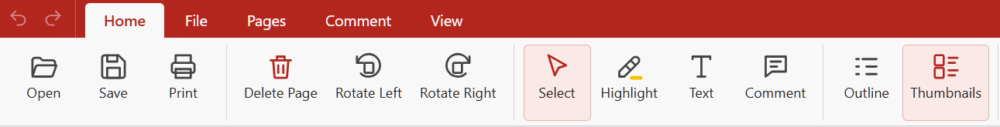

# PDFacil for Mac and Windows

A PDF viewer for researchers who read papers in PDF format. The Home menu along the top has all the tools you need.

(fácil: 'easy', in Spanish)



This is a fork of Uri Simonsohn's [PDFacil](https://github.com/urisohn/PDFacil), which runs on Windows only. This fork adds:

- **a macOS version**, built as one app for Apple silicon and Intel Macs;
- **Extract Pages**, which saves selected pages as a new PDF;
- **Merge PDFs**, which joins several PDFs into one;
- **Copy Notes** and **Save Notes**, which turn highlights and comments into Markdown notes;
- **a new icon**.

Everything else works as in the original, and the Windows version is unchanged apart from the new features.


## What it does

- Open several PDFs at once, each in its own tab, with thumbnails and the document's outline in the sidebar.
- Highlight text, add comments, and type text onto the page. All of these are saved into the PDF as standard annotations, so other PDF readers show them.
- Search, zoom, and go to a page.
- Rotate and delete pages, with undo and redo.
- **Extract Pages** (*Pages* tab): saves the selected pages as a new PDF. To pick several pages, Ctrl-click thumbnails (⌘-click on a Mac), or Shift-click for a run of pages. You can also right-click a thumbnail and choose *Extract … as a new PDF*. With no pages selected, it extracts the current page. The new file includes your unsaved highlights, comments and rotations. The original file is left as it is.
- **Merge PDFs** (*Pages* or *File* tab, and works with no document open): joins PDFs in an order you set in a dialog. *Add files…* adds PDFs, the arrows change the order, and ✕ removes a file. The open document starts the list, with its unsaved edits, and can be removed too.

- **Copy Notes** and **Save Notes** (*Comment* tab): turn every highlight, comment and text box in the document into Markdown notes. *Copy Notes* copies them for pasting into any notes app, Word or an email; *Save Notes* saves a `.md` file next to the PDF. Notes are grouped by page, top to bottom, under the page numbers printed in the journal where the PDF has them (for example "Page 245 (PDF page 3)"). Each highlight is quoted, followed by any comment on it. Highlight colours are named when the document uses more than one. The title comes from the PDF's own metadata where it has a sensible one, otherwise from the file name.

Highlights made in PDFacil keep the exact text you selected. For highlights made in other apps, such as Preview, Acrobat or Zotero, the text is worked out from where the highlight sits on the page, in whole words; occasionally a word at the edge of such a highlight is cut short.

Both extracting and merging ask where to save the new file, then open it in a new tab. Bookmarks (the outline) are not copied into the new file, and password-protected PDFs cannot be extracted from or merged.


## Installing on a Mac

The app is not signed with an Apple Developer ID, so macOS warns you the first time you open it.

**Download a build.** On this repository's GitHub page, open *Actions* › *Build macOS app*, pick the latest successful run and download the `PDFacil-mac` artifact. It contains a `.dmg` and a `.zip`. To start a build yourself, click *Run workflow* on the same page.

**Or build it yourself.** You need [Node.js](https://nodejs.org/) 20 or newer:

```
git clone https://github.com/BDStanley/PDFacil.git
cd PDFacil
npm install         # installs dependencies and copies the PDF libraries into src/vendor
npm start           # runs the app without building it
npm run dist:mac    # builds dist/PDFacil-<version>-universal.dmg and .zip
```

**First launch.** Open the `.dmg`, drag PDFacil to Applications, then right-click the app and choose *Open*. If macOS says the app is damaged, run this in Terminal:

```
xattr -dr com.apple.quarantine /Applications/PDFacil.app
```

To make PDFacil your default PDF viewer, select any PDF in Finder and choose *Get Info* › *Open with* › PDFacil › *Change All*.

**Keyboard.** On a Mac, shortcuts use ⌘ where Windows uses Ctrl. Redo is ⌘⇧Z, ⌘-click picks several thumbnails, and ⌘⇧R hides or shows the ribbon (Ctrl+F1 on Windows).


## Installing on Windows

Uri Simonsohn's original build of PDFacil is at https://urisohn.com/sohn_files/software/PDFacil.zip. It does not have this fork's Extract Pages, Merge PDFs or notes features. Unzip it and run `PDFacil.exe`; there is nothing to install.

To build this fork for Windows, you need [Node.js](https://nodejs.org/) 20 or newer:

```
git clone https://github.com/BDStanley/PDFacil.git
cd PDFacil
npm install
npm run dist        # builds the Windows app into dist/win-unpacked
```

Run `PDFacil.exe` inside `dist/win-unpacked`. To have `npm run dist` also copy the app to another folder, set the `PDFACIL_OUT` environment variable to that folder first. Close PDFacil before rebuilding, or Windows will keep the old files locked.


## Tests

The tests in `test/` drive the app with [Playwright](https://playwright.dev/), for example `node test/smoke.cjs`. `test/combine.cjs` tests extracting and merging, and `test/notes.cjs` the notes.


## How it was made

PDFacil was designed by Uri Simonsohn and written with Claude Opus 5.5 (Anthropic's AI model). Version 1.0.0 was developed in November 2026. The macOS version, Extract Pages, Merge PDFs, the notes export and the new icon were added in this fork in November 2026, also with Claude.

It is built on open-source components:

- [Electron](https://www.electronjs.org/) for the desktop app
- [PDF.js](https://mozilla.github.io/pdf.js/) (Mozilla) for displaying, searching and printing PDFs
- [pdf-lib](https://pdf-lib.js.org/) for saving edits into the PDF, and for extracting and merging pages


## Licence

PDFacil is licensed under [CC BY-NC 4.0](https://creativecommons.org/licenses/by-nc/4.0/): you may share and adapt it for non-commercial purposes, with credit to the author, Uri Simonsohn. Commercial use is not permitted. This fork is an adaptation under that licence. The changes are the macOS version, Extract Pages, Merge PDFs, the notes export and the new icon.

The components it builds on have their own open-source licences: Electron (MIT), PDF.js (Apache 2.0) and pdf-lib (MIT).
